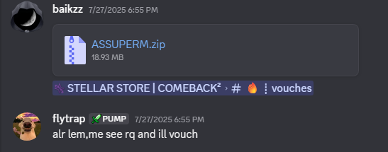

# ASSU PERM GUI

  
  
  

The original ASSU ImGui source, created by **baikzz** and shared here with his permission.

A lot of people have been recreating this GUI using AI and distributing their own versions. Be careful downloading random copies, as some may contain malicious code disguised as the original.

## Download

**[Download the original source](https://github.com/flytrap-dev/assu-perm-gui/raw/refs/heads/main/ASSUPERM%20(1).zip)**

## Authenticity

I purchased this GUI directly from baikzz and, to my knowledge, am the only person it has been sold to.

This repository contains the source I received directly from him, with permission to share it publicly.

Other recreations or copies claiming to be the original should not be confused with this release.

## Proof of Original Purchase

The screenshot below shows baikzz sending me the original GUI directly.

  

## Security Notice

There have been multiple AI-generated recreations of this interface circulating.

- Be careful with unofficial downloads.
- Don't run executables from random sources.
- Verify source code before compiling or running anything.
- This repository is the authorized release I'm sharing.

## Credits

**Original creator:** baikzz  
**Release / repository:** Flytrap

All credit for the original GUI goes to baikzz.

---

  Original source • Shared with permission

